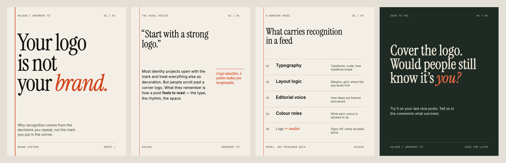

# Instagram Visual Identity — a Claude skill

A skill for Claude Code and Claude.ai that reverse-engineers visual references and turns them into a scalable Instagram brand identity system.

Russian version: [decodengrow/instagram-visual-identity](https://github.com/decodengrow/instagram-visual-identity)

## What it does

Works in 10 stages:

1. Analysis of each reference: composition, typography, color, graphic language, imagery, information architecture, semiotics
2. Cross-reference patterns: comparison matrix, visual DNA, contradictions, confidence levels
3. Three distinct creative directions and a choice of the strongest
4. Identity architecture: color (HEX), typography, grids, signature elements, consistency rules
5. Carousel architectures A–G, covers, inner and closing slides
6. Formats beyond carousels: single posts, Reels, Stories, series
7. Content-to-design translation
8. Production specs for slides, with coordinates
9. Quality control against 12 criteria
10. A 15-section final deliverable and a master prompt for future posts

## Example



An illustrative excerpt for a fictional brand — direction, color and type tokens, grid, a slide-by-slide spec, QC scores and a master prompt: [examples/EXAMPLE.md](examples/EXAMPLE.md).

## Installation

**Claude Code:**

```bash
git clone https://github.com/decodengrow/instagram-visual-identity-en ~/.claude/skills/instagram-visual-identity-en
```

**Claude.ai:** download the repository as a ZIP and upload it under Settings → Capabilities → Skills.

## Usage

Share your references (post screenshots, a moodboard) and briefly describe the brand, e.g. "Analyze these references and build an Instagram visual system". The skill triggers automatically, or call it explicitly: `/instagram-visual-identity-en`.

## Structure

```
SKILL.md              — role, process, deliverable order, principles
references/stages.md  — detailed per-stage checklist and master prompt template
```

## License

MIT — see [LICENSE](LICENSE).
